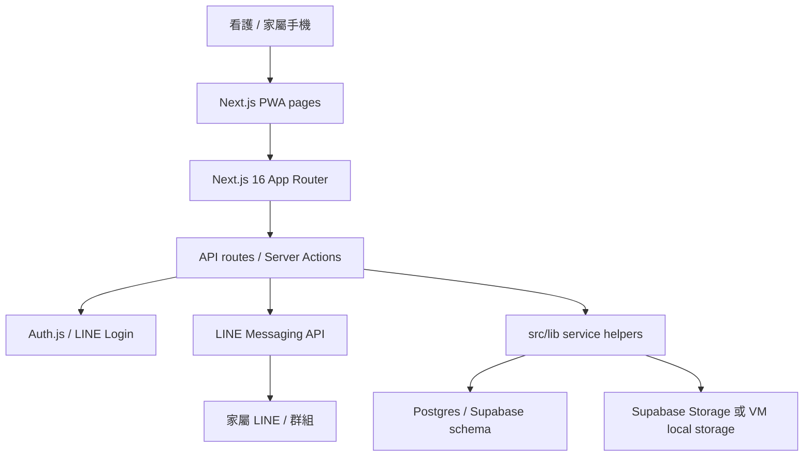

# CareTaiwan 架構摘要

日期：2026-07-01

這份文件是公開導覽版。詳細接手架構整理請看 [SYSTEM_ARCHITECTURE_PLAN.md](./SYSTEM_ARCHITECTURE_PLAN.md)。

## 目前形狀

## 層級說明

- Client pages：看護端、家屬端、備份、醫護卡與日常紀錄。
- API routes：登入狀態、配對、照片、家屬資料、cron、LINE webhook。
- Server actions：推播與登入登出相關流程。
- Service helpers：`src/lib/*`，封裝 pairing、origin check、rate limit、照片與 Supabase 存取。
- Data layer：目前以 Supabase Postgres / Storage 為原架構，正式 VM 可能改為自管 Postgres 或 managed service。

## 邊界

- Client component 不碰 service-role client。
- API route 要做身份、ownership、同源與 rate limit 檢查。
- LINE webhook 先驗簽，再處理事件。
- 資料庫、檔案儲存、Redis 與管理介面不得直接暴露到 public internet。
- 醫療相關提醒只做日程提醒，不做醫療判斷。

## 待補

- 正式 migration series。
- CI/CD 測試閘門。
- API route 測試。
- 正式 VM runbook。
- 隱私權政策與服務條款的法律主體切換。
