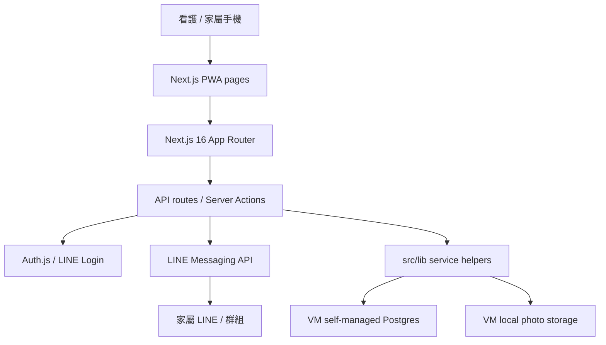

# CareTaiwan 系統架構整理

日期：2026-07-01

這份文件先把目前系統攤開。它還不是最終架構書，只是接手維護時的第一張地圖。現在最怕的是一邊修 bug、一邊順手改資料庫、部署方式和前端結構，最後誰也說不清楚系統真正長什麼樣子。

## 目前系統長相

CareTaiwan 現在是一個 Next.js PWA。看護端和家屬端頁面都放在同一個 `src/app` 裡，API route、server action、LINE webhook 也在同一個專案內。資料層主要靠 Supabase Postgres。後續正式部署會走 VM 方向，部署細節要另外整理。

簡化後可以這樣看：

```text
看護 / 家屬手機
  |
  | PWA / Next.js pages
  v
Next.js 16 App Router
  |-- client pages：紀錄、醫護卡、備份、家屬頁
  |-- API routes：auth/session、pairing、photo、expense、cron、LINE webhook
  |-- server actions：推播、登入登出
  |
  | Auth.js / LINE Login
  | LINE Messaging API
  v
資料與檔案
  |-- Supabase Postgres / Storage（原架構）
  |-- 正式 VM 部署路線待定
```



## 先不急著換的東西

目前不建議馬上重寫語言、框架或整套資料庫。理由很簡單：現在最大的問題是邊界不清、文件不完整、測試不足，不是 TypeScript 或 Next.js 本身不能用。

短期先保留：

- 開發語言：TypeScript。
- 前端與後端框架：Next.js 16 App Router。
- UI：React 19 + Tailwind CSS 4 + Lucide React。
- 認證：Auth.js v5 + LINE Login。
- 推播：LINE Messaging API。
- 主要資料模型：Postgres。
- 原作者部署參考：Vercel。
- 正式部署方向：VM。Docker 可作為部署包裝方式，但要補正式 runbook。

這些東西可以繼續用，但要補上規範。沒有規範，再好的技術也會變成一團。

## 需要重新決定的地方

### 資料庫與部署

目前需要做的是把正式 VM 部署路線寫清楚。原作者版本使用 Supabase managed Postgres + Storage；中揚資訊後續若要部署到 VM，就要決定資料庫、檔案儲存、備份、監控和權限怎麼處理。

短期先不要在程式裡同時維護多套正式假設。建議做法：

1. 先決定正式 VM 是否仍使用 Supabase managed service，或改成 VM 內的 Postgres / object storage。
2. 在 `.env.example` 裡標清楚 production 必填變數。
3. 若 VM 自管資料庫，補 migration、backup、restore、監控與權限管理流程。
4. 正式資料庫已決定採 VM 自管 Postgres；補 Postgres 網路隔離、帳號權限、備份、restore drill、監控與告警說明。

### VM 基礎設施安全基準

正式部署不綁定特定供應商。只要環境能符合這裡列出的網路、備份、日誌、密鑰與維運要求，公有雲 VM、私有雲、主機代管或地端伺服器都可以納入。文件先採用供應商中立的安全基準，之後只在 runbook 裡補各環境的差異，不把產品架構寫死在某一家廠商上。

第一版 VM 安全基準如下：

- 網路隔離：公開網路只開反向代理與必要的 app port。資料庫、檔案儲存、Redis、內部管理介面只能走 private network 或本機 socket，不開 public database port。
- 管理入口：SSH 不直接對全網開放。正式環境應使用 VPN、bastion host、固定來源 IP allowlist 或等效控管，並停用密碼登入。
- 防火牆：security group / firewall 採 deny-by-default。新增 port 要寫進部署 runbook，不能只在 VM 上手動放行。
- 密鑰管理：`.env`、service-role key、LINE token、cron secret 不進 git。正式環境使用雲端 secret manager，或至少使用受限權限檔案與輪替紀錄。
- 備份加密：資料庫與檔案備份要加密保存，且至少有一份離開原 VM。備份要定期做 restore drill，不只檢查檔案存在。
- 刪除請求與備份：使用者要求刪除資料時，live database / storage 要執行刪除；已打包的歷史備份原則上不直接拆包修改，但要記錄刪除請求，並在備份到期時自然覆蓋。備份保留期要短而明確，不能無限期保存含個資備份。
- 日誌保存：app audit log、reverse proxy access / error log、系統登入紀錄與部署紀錄要有保存期限、輪替規則與查閱權限。
- 防竄改：重要稽核日誌應送到 VM 外部位置，或採 append-only / object lock 等等效機制。至少不能讓單一 app 權限同時能寫入、修改與刪除全部稽核資料。
- 個資遮蔽：log、audit metadata、錯誤 response、LINE push 記錄預設不放完整 LINE user ID、姓名、電話、照片 URL 或醫療備註。必要時只留遮蔽值或 hash。
- 更新與弱點處理：OS patch、Node.js / npm dependency、Docker image rebuild 要有固定檢查節奏。重大弱點要能回滾到前一版。
- 事件處理：要有資安事件 runbook，至少包含通報窗口、停權方式、備份還原、token rotation、資料刪除請求與對外說明流程。
- 可攜性：部署腳本、環境變數、backup / restore 流程與 health check 要避免依賴單一供應商專有功能。若某環境需要專有服務，必須在 runbook 裡寫出替代方案或退出方式。

這裡引用的是 ISO 27001 的管控精神，不是在宣稱本專案已取得任何認證。若未來要與公部門、醫療院所或長照單位對接，這些紀錄會變成基本審查資料。

### API 邊界

目前 API route、server action、LINE webhook 和資料 helper 混在同一個 Next.js 專案裡。以這個規模來說可以接受，但要補規則：

- 對外 API route 負責身份驗證、同源檢查、rate limit、輸入驗證。
- `src/lib/*` 負責可重用的資料邏輯與第三方服務封裝。
- client component 不碰 service-role client。
- LINE webhook 只做 webhook 需要的事，不要把一般業務流程塞進去。

### 設計規範

目前 UI 主要靠 Tailwind class、少量共用 component 和字典檔。這可以先用，但需要補一份輕量規範：

- 主要流程：看護端紀錄、醫護卡、備份、家屬端配對、家屬端核帳。
- 元件規則：按鈕、表單、底部導覽、狀態提示、危險操作確認。
- 文案規則：繁體中文為主，多語字典同步更新。
- 無障礙底線：可讀字級、足夠對比、可點擊範圍、錯誤訊息不能只靠顏色。

不需要一開始導入大型 design system。先把現有規則寫下來，新增功能照規則走。

### 新需求：行事曆與請假

使用者已提出行事曆需求：外籍看護需要提前知道回診等後續安排，也會有請假情境。這不是單純新增一個畫面，因為它會新增「未來行程」和「請假紀錄」兩種資料。

先把需求放在 `../product/USER_REQUIREMENTS.md`。架構上暫定：

- 不塞進既有照護紀錄 `records`。
- 不塞進配對資料 `elder_pairings`。
- 另開 `care_events` 和 `caregiver_leave_requests` 這類資料模型。
- `care_events` 要保留 `is_medical_related` 這類明確欄位，讓 UI 與 LINE 推播能對回診、拿藥、檢查等提醒加上免責文字。
- 第一版只做照護行程與請假紀錄，不做排班、薪資或醫院掛號系統串接。

正式實作前，要先決定 production 資料庫路線。否則 migration 寫在 Supabase 版本，VM 又另外補一套，後面會更亂。

### 測試與品質閘門

目前已建立第一批 Vitest helper tests。這是好的開始，但還不夠；配對、推播、刪除資料、照片權限都不能長期只靠人工點一輪。

第一批已落地或應優先補齊的測試先放在純 helper：

- pairing code TTL、自我配對限制。（已建立）
- origin allowlist。（已建立）
- cron bearer token 與 LINE user ID 去識別化 reference。（已建立）
- rate limiter fallback。
- photo magic-byte detection。
- audit metadata redaction。

等這些穩定，再補 API route 測試與 E2E。

正式建置 Docker image 前，應透過 CI pipeline 強制執行 `npm run lint` 與自動化測試。測試失敗不得產生 production image；lint 目前應維持無 warning。若未來新增 warning，要在同一個 PR 修掉，或建立明確 issue 與期限，不能讓 warning 長期變成背景噪音。

## 暫定架構決策

| 類別 | 短期決策 | 原因 | 之後要補 |
|---|---|---|---|
| 開發語言 | 保留 TypeScript | 現有程式已是 TS，重寫沒有回報 | 補型別邊界與測試 |
| 框架 | 保留 Next.js 16 | PWA、API route、server action 都已在此架構上 | 補 Next.js 16 注意事項與升級策略 |
| 資料庫 | 保留 Postgres 思路 | 現有 schema 以 Postgres 為核心 | 決定 VM 自管或 managed service |
| Storage | VM local storage | 開發期與單 VM 部署改動最小，現有程式已有 local signed URL 支援 | 補容量監控、備份與 restore drill；多台 app server 前重新評估 shared storage |
| Auth | 保留 LINE Login / Auth.js | 符合台灣使用情境 | 補 session / callback / PWA 測試 |
| 推播 | 保留 LINE Messaging API | 家屬端最符合現實使用習慣 | 補 webhook runbook |
| 設計規範 | 先補輕量規範，不導入大型設計系統 | 現有規模不需要重工具 | 整理元件與文案規則 |
| 行事曆 / 請假 | 先列需求，不直接動 schema | 會新增資料模型與權限問題 | 先確認範圍，再寫 migration |
| 部署 | 正式環境改以 VM 為方向 | Vercel 是原作者參考 | 補 VM runbook |

## 接下來的做法

先不要開大規模重構。接下來的順序應該是：

1. 補文件邊界：哪些是原作者保留文件，哪些是中揚資訊接手後新增。
2. 補環境與部署範例：`.env.example`、`docker/.env.production.example`、VM 部署文件要同步。
3. 擴充最小測試：先補 rate limiter、photo magic-byte、audit metadata，不碰 UI。
4. 補 API route 與 LINE webhook 邊界測試，讓資料權限與 webhook signature 不只靠人工檢查。
5. 釐清行事曆 / 請假需求範圍。
6. 依 VM 自管 Postgres 路線補 production migration series、backup / restore runbook 與 rollback 操作。

這樣做比較慢，但比較不會把原本已經混在一起的責任再混得更深。
